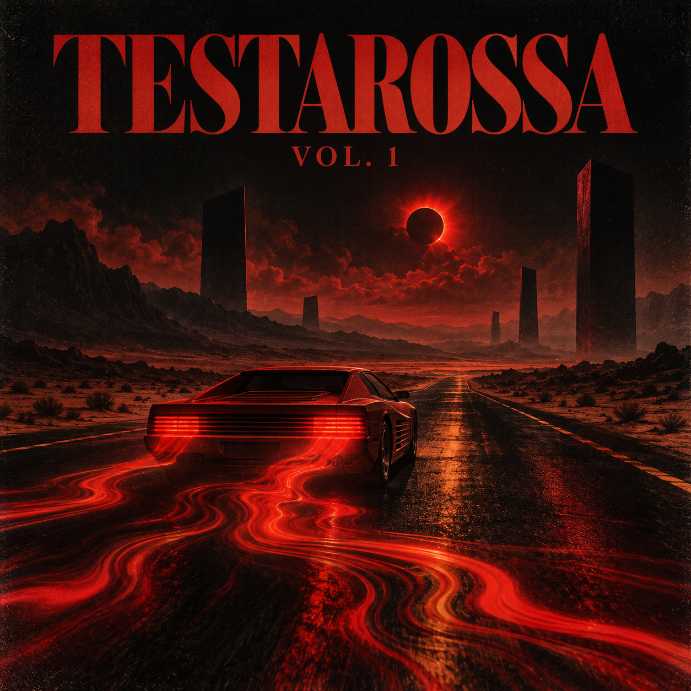

# TESTAROSSA VOL. 1 — Atmos Edition

**A free sound bank of 64 presets for the Dreadbox Typhon.** Deep subs, basses, leads, plucks, evolving textures and cinematic effects for dark, spacious productions.

The current **Atmos Edition** revisits the sounds with more prominent delay on leads, ensemble and reverb on atmospheric patches, plus changes to filters, envelopes and modulation. All 64 updated presets have been loaded onto a Typhon and read back to verify their stored settings. Musical quality and uniqueness against other sound banks have not been independently verified.

## Sound demo

[Watch the 34-second reel: 16 solo Typhon sounds](Testarossa-vol1-16-solo-reel.mp4)

## Download

- **Current version:** [Download Testarossa Vol. 1 — Atmos Edition](https://github.com/karlalex732-dotcom/testarossa-vol1-typhon/raw/refs/heads/main/Testarossa-vol1-Atmos.zip)
- **Previous version:** [Download the FX Edition](https://github.com/karlalex732-dotcom/testarossa-vol1-typhon/raw/refs/heads/main/Testarossa-vol1-FX.zip)
- **Original version:** [Download the original bank](https://github.com/karlalex732-dotcom/testarossa-vol1-typhon/raw/refs/heads/main/Testarossa-vol1-bank.zip)

Each archive contains 64 `.typhonpr` files. Character and levels can vary with notes, firmware, and the rest of your signal chain.

## Install

1. Download and unzip the archive.
2. Back up the presets already on your Typhon before transferring anything.
3. Open Dreadbox Preset Manager, import the `BANK A` folder and place the sounds in the desired slots of your working bank set.
4. Send the working bank set to your Typhon. **Sending can overwrite presets already in the instrument.**

Download the official Preset Manager and manual from [Dreadbox support](https://dreadbox-fx.com/support/).

## Бесплатный банк для Typhon

64 пресета: басы, лиды, щипковые звуки, атмосферы и эффекты. В актуальной версии **Atmos Edition** лиды получили более выраженный delay, атмосферные звуки — ансамбль и реверберацию; также переработаны фильтры, огибающие и модуляция. Скачать банк можно бесплатно по ссылке выше; перед загрузкой сделайте резервную копию своих звуков.

This is an independent sound bank and is not affiliated with or endorsed by Dreadbox. Dreadbox and Typhon are trademarks of their respective owners.
